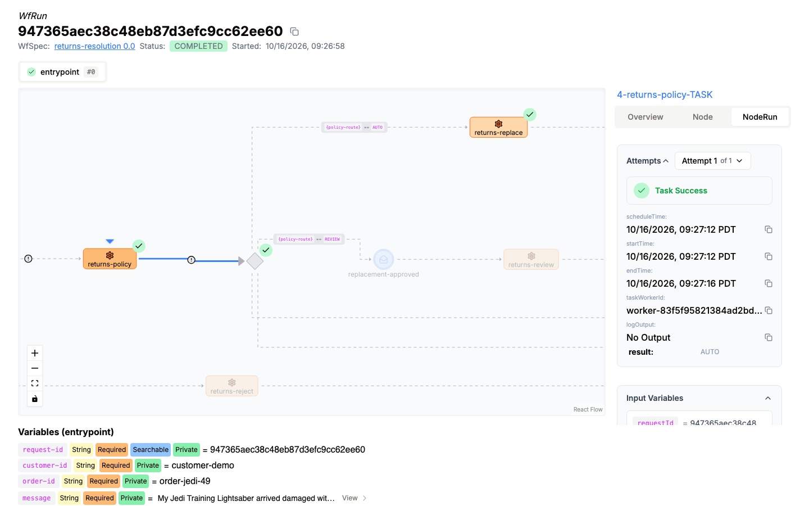
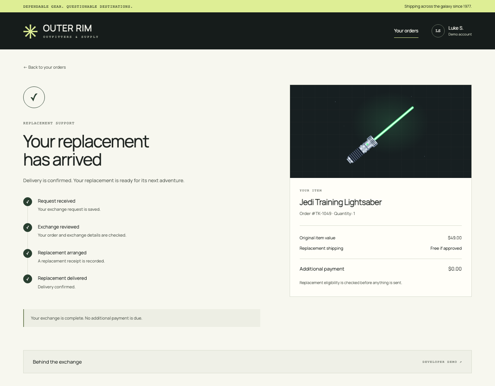
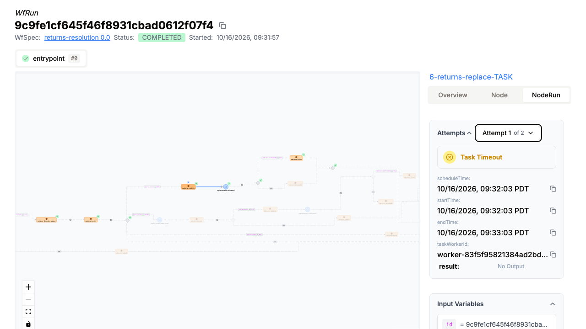
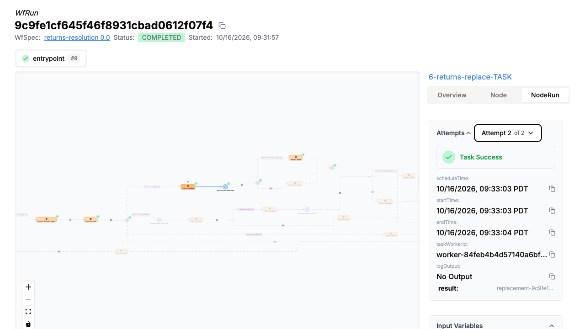
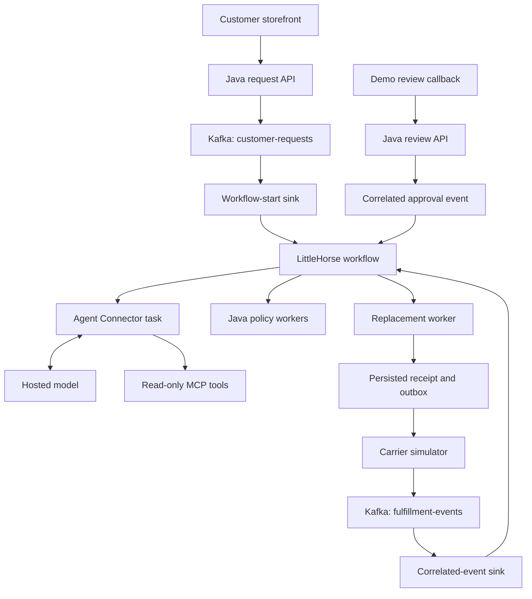

# AI-assisted returns with LittleHorse

A customer reports a damaged lightsaber. An AI agent checks the order, policy and available replacements. Java decides whether the request can proceed automatically or needs review. [LittleHorse](https://github.com/littlehorse-enterprises/littlehorse) coordinates the work until delivery, including waits and recovery if a worker crashes.

**The point of this demo:** an AI recommendation is one step in a business process. The process still needs trusted rules, durable progress, external events and safe retries. This repository shows those responsibilities working together in a runnable Java application, with the native LittleHorse Dashboard exposing each step.

The story follows **Outer Rim Outfitters**, an unofficial Star Wars fan store:

- A **$49 Jedi Training Lightsaber** qualifies for automatic replacement.
- A **$299 Sith lightsaber** requires a reviewer to approve or reject the replacement.
- If the replacement worker crashes after saving a receipt, a retry must reuse that receipt rather than create another replacement.

Start with `normal`, then `review`, then `recovery` after [setting up the stack](#getting-started). Together they show the happy path, a process waiting for a decision, and a process surviving a crash. The customer storefront shows the outcome; the Dashboard shows how it happened.

## Why use LittleHorse here?

Without an orchestrator, the application would need to track which step each request reached, schedule retries, remember pending reviews, match arriving delivery events and expose that history for debugging. LittleHorse supplies the workflow execution machinery. Engineers define the process in Java and implement workers for the business operations.

That leaves clear boundaries: **AI proposes, Java enforces policy and performs actions, Kafka transports business messages, and LittleHorse coordinates execution.** The application still owns persistence and idempotency for its replacement effect. A workflow retry alone cannot make an external action safe to repeat.

Three terms make the Dashboard easier to read:

| Term | Meaning in this demo |
| --- | --- |
| **WfSpec** | The registered process definition: validate, consult the agent, apply policy, replace and wait for delivery. |
| **WfRun** | One customer's execution of that process, identified by the request ID. |
| **Task / worker** | A unit of work and the process that executes it. LittleHorse schedules tasks; Java workers and Agent Connector execute them. |

[](docs/images/workflow.png)

*A completed WfRun, focused on the successful policy task and its `AUTO` result. [ReturnsWorkflow.java](src/main/java/io/littlehorse/returns/ReturnsWorkflow.java) defines this graph. All screenshots show real execution with synthetic orders. Select an image to open it at full size.*

## What this example demonstrates

| Capability | Where to see it |
| --- | --- |
| **AI agents inside a workflow** | Agent Connector calls three read-only MCP tools and returns a proposed resolution. |
| **Policy enforcement** | Java checks trusted order facts and the $100 automatic-approval limit. |
| **Waiting for external events** | Review and delivery events resume the matching request using its correlation ID. |
| **Retries with a durable effect** | A fulfillment worker crashes after saving a receipt. Its retry reuses that receipt. |
| **Kafka integration** | One connector starts workflows from requests; another delivers correlated business events. |
| **Execution visibility** | The native Dashboard shows the graph, variables, task inputs, results and attempts. |

## Getting started

### Prerequisites

- Docker with Docker Compose, with roughly 8 GB of memory available for the local stack.
- Python 3 for the setup and scenario scripts.
- An Anthropic API key and internet access for images and model calls. Provider usage is billed to your account.

The Java application builds inside Docker. Local development checks additionally require Java 21 and Node.js. The Agent Connector uses the digest-pinned, published LittleHorse 1.3.0 image.

### Configure the model

Clone the example and create your local configuration:

```bash
git clone https://github.com/littlehorse-enterprises/lh-returns-demo.git
cd lh-returns-demo
cp .env.example .env
```

Privately edit the ignored `.env` file. The default configuration uses Anthropic:

```dotenv
MODEL_NAME=claude-haiku-5-5
MODEL_API_KEY=<your API key>
```

The demo has been tested end to end with `claude-haiku-5-5`, listed in [Anthropic's model catalog](https://platform.claude.com/docs/en/models/overview). It calls Anthropic directly through the published Agent Connector adapter.

After changing model configuration, run `./scripts/setup.sh` without `--reuse-agent` so the configuration is applied.

Do not commit `.env` or share resolved Compose configuration, which can contain the key.

### Start the stack

```bash
./scripts/setup.sh
```

Setup starts LittleHorse, a separate business Kafka broker, Kafka Connect, the Java app, a carrier simulator and the actual Agent Connector. It registers the workflow and event definitions before installing the two sink connectors. Images and dependencies take longer on the first run.

| Open | Address |
| --- | --- |
| Customer storefront | [localhost:8091](http://localhost:8091) |
| LittleHorse Dashboard | [localhost:8080](http://localhost:8080) |

Run a complete exchange from the terminal:

```bash
./scripts/demo.sh normal
```

The script prints the request ID and Dashboard link. A successful check requires a native `COMPLETED` workflow, all three recorded tool reads, one replacement receipt and confirmed simulated delivery.

## Walk through an exchange

Keep the storefront and Dashboard open side by side. For terminal scenarios, use the run link printed by the script. Follow the same request ID throughout; each scenario creates a separate run.

The successful path is:

**Request → validate → agent proposal → Java policy → optional review → replacement → delivery event → completed.**


### 1. Submit the customer's request

Open the storefront, choose the Jedi Training Lightsaber, and request a replacement. The return reasons include damaged shipping, ignition trouble and sand in the hilt. Your saved exchange URL continues to show the recorded result after a refresh.

[](docs/images/customer-exchange.png)

*The customer page reports business outcomes. Expand “Behind the exchange” for the recorded tools, policy, receipt and native workflow status.*

The app publishes a record to `customer-requests`. The request ID is also the Kafka record key and the LittleHorse workflow-run ID, so the same business request can be traced across the components.

### 2. Inspect the agent's recommendation

Follow the run into the LittleHorse Dashboard. The workflow first validates the request, then runs `returns-decision-agent`. The agent reads these MCP tools:

- `get_order`: the customer's order and item facts.
- `get_policy`: the applicable replacement policy.
- `get_fulfillment_options`: replacement availability.

The agent returns a JSON proposal, stored in the run’s `agent-proposal` variable. The `returns-policy` Java task checks it against trusted facts and records `policy-route`. The model has no approval or fulfillment tool: unsupported proposals cannot authorize a replacement.

*Open a task's input and output dialogs to inspect what the agent received and returned. Tool-read evidence is also recorded by the application's MCP adapter.*

### 3. Apply policy and wait for review

Look for `AUTO` or `REVIEW` in `policy-route`. The $49 order follows the automatic path. The $299 Sith order pauses at the `replacement-approved` event, correlated to the request ID. The run resumes when that decision arrives; the agent does not need to stay in a conversation while it waits. The terminal scenarios exercise both review outcomes:

```bash
./scripts/demo.sh review
./scripts/demo.sh rejection
```

Each command creates its own request, waits for the review gate, then sends the local demo approval or rejection callback. Rejection completes the workflow without creating a replacement.

<details>
<summary>Review a request you submitted through the storefront</summary>

Copy its request ID from the saved exchange or native run, then call the local demo endpoint:

```bash
REQUEST_ID=your-request-id
curl --fail-with-body \
  -X POST "http://localhost:8091/api/cases/$REQUEST_ID/review" \
  -H 'Content-Type: application/json' \
  -d '{"approved":true}'
```

Use `false` to reject. This callback demonstrates a review boundary; it does not implement production reviewer identity or permissions.

</details>

### 4. Recover without creating another replacement

```bash
./scripts/demo.sh recovery
```

The worker saves a synthetic replacement receipt and pauses before acknowledging its task. The scenario kills only the app process during that window, then starts it again. LittleHorse retries the task, and the worker returns the existing receipt.

[](docs/images/retry-timeout.png)

*Attempt 1: the worker saved its receipt, but died before acknowledging the task. The native Dashboard records a timeout with no output.*

[](docs/images/retry-success.png)

*Attempt 2: the worker returns the persisted receipt. Open the [full native output dialog](docs/images/retry-receipt.png) to inspect its identifier. The recovery scenario also checks the application's recorded effect count; the screenshot alone does not establish deduplication.*

### 5. Follow delivery to completion

A separate carrier process reads the persisted outbox and publishes to `fulfillment-events`. The second Kafka sink posts the correlated `replacement-delivered` event. The workflow then records delivery and completes.

In the Dashboard, confirm that the delivery wait received its event and the run reached `COMPLETED`. In the customer exchange, confirm the recorded receipt and delivery status. A completed run means the process finished; inspect its business result too, because a rejected request also completes successfully without a replacement.

## How the pieces fit together

Kafka carries the business requests and delivery messages. LittleHorse owns workflow execution, task scheduling, retries and event waits. The business broker is separate from the broker inside the standalone LittleHorse image.



| Component | Responsibility | Source |
| --- | --- | --- |
| Agent runtime | Anthropic inference, read-only tool calls and checkpointed conversation | [Published Agent Connector](https://github.com/littlehorse-enterprises/lh-agent-connector) |
| Workflow | Branching, retries, review/delivery waits and failure paths | [ReturnsWorkflow.java](src/main/java/io/littlehorse/returns/ReturnsWorkflow.java) |
| Java workers | Identity validation, trusted policy and idempotent replacement | [ReturnsTasks.java](src/main/java/io/littlehorse/returns/ReturnsTasks.java) |
| Customer API and MCP | Request submission, read-only tools and demo callbacks | [ReturnsHttpServer.java](src/main/java/io/littlehorse/returns/ReturnsHttpServer.java) |
| Persistent store | Request identity, atomic case snapshots and receipts | [CaseStore.java](src/main/java/io/littlehorse/returns/CaseStore.java) |
| Carrier | Pending delivery outbox and Kafka publication | [CarrierScheduler.java](src/main/java/io/littlehorse/returns/CarrierScheduler.java) |
| Kafka sinks | Workflow-start and correlated-event mappings | [Connector configurations](infrastructure/connectors) |
| Local stack | Services, pinned images, ports and volumes | [compose.yaml](compose.yaml) |

See [infrastructure details](infrastructure/README.md) for startup ordering, topic contracts and persistence, or [the presenter walkthrough](RECORDING.md) for a shorter demo sequence.

## Run the scenarios

| Command | What it checks |
| --- | --- |
| `./scripts/demo.sh normal` | Automatic replacement, tool reads, receipt and native completion. |
| `./scripts/demo.sh review` | High-value request waits for approval, then completes. |
| `./scripts/demo.sh rejection` | Rejection issues no replacement. |
| `./scripts/demo.sh recovery` | Crash after persistence, retry and receipt reuse. |
| `./scripts/demo.sh duplicates` | Replayed records reach both sink offsets; the same run retains one effect. |
| `./scripts/demo.sh carrier-restart` | A pending outbox survives an independent carrier restart. |
| `./scripts/demo.sh timeouts` | Review and delivery deadlines escalate safely; normal waits and the carrier are restored. |
| `./scripts/smoke.sh` | All of the above. |

These scenarios use real infrastructure and model calls. Recovery restarts the owned app; carrier and timeout checks stop/start the owned carrier. Timeout checks temporarily register shorter event deadlines. Run them sequentially, without another process changing workflow registration.

### Scope and current limitations

Customers, orders, policy/inventory services, replacement receipts, the review callback and carrier delivery are simulated. Kafka, LittleHorse, the Agent Connector, model inference and MCP calls are real.

Java enforces the fixture's customer/order identity, replacement eligibility, trusted price threshold and required approval. Interpreting whether free-form customer text describes damage is still the model's job; this example does not deterministically verify that claim. The HTTP endpoints use a fixed demo customer and unauthenticated reviewer simulator. Keep the stack on localhost; it is not a production customer or reviewer authentication system.

Stable request IDs and persisted receipts deduplicate this demo's replacement effect. An outbox publication can replay after a crash between Kafka acknowledgement and saving its local marker. Arbitrary external APIs need their own idempotency strategy.

The scenarios above have passed on a clean, isolated Compose installation using the default Anthropic configuration, including real model calls and all three MCP reads. The standalone engine has also exhibited intermittent Kafka transaction failures; its bounded supervisor can restart it after sustained readiness loss, but the initiating failure remains unresolved. These results do not establish production availability or recovery guarantees.

## Development

Run application and frontend checks with Java 21 and Node.js:

```bash
./gradlew --no-daemon test installDist
node scripts/test-storefront.cjs
```

Run the script and configuration checks:

```bash
python3 scripts/test-scenarios.py
python3 scripts/test-startup.py
python3 scripts/test-supervisor.py
python3 scripts/test-connectors.py
python3 scripts/test-project-isolation.py
python3 scripts/test-compose-images.py
```

Startup/supervisor process tests need GNU `timeout` (`gtimeout` on macOS). Configuration tests need the Compose CLI and use synthetic temporary configuration without a running Docker daemon. These checks complement the live scenarios; they do not call a model or prove end-to-end acceptance.

The Agent Connector is a published upstream image; this example contains no custom model adapter. Use `./scripts/demo.sh normal` to verify real inference, all three MCP reads and workflow completion.

GitHub Actions runs the Java, storefront and script checks, builds the app and Kafka Connect images, and verifies that the published Agent Connector image is available. Live model and full-stack acceptance remain separate from CI.

### Repeat setup

With an already healthy agent and locally built images in the same project:

```bash
./scripts/setup.sh --reuse-agent --reuse-images
```

This retains the existing agent configuration and repeats topic, workflow and connector provisioning. Failed connector tasks can be restarted once; persistent failures stop setup. Use ordinary setup for a first build.

<details>
<summary>Run a separate local stack</summary>

Set these non-secret variables in the shell used for setup, scenario and cleanup commands:

| Variable | Default | What to change for a second stack |
| --- | --- | --- |
| `COMPOSE_PROJECT_NAME` | `lh-returns-demo` | A distinct project/network/volume prefix. |
| `DEMO_APP_IMAGE` | `lh-returns-demo-app:local` | A distinct tag shared by app, carrier and registration. |
| `DEMO_CONNECT_IMAGE` | `lh-returns-demo-connect:1.3.0` | A distinct Connect build tag. |
| `APP_PORT` | `8091` | An unused customer/API port. |
| `DASHBOARD_PORT` | `8080` | An unused Dashboard port. |
| `LH_PORT` | `2023` | An unused native API port. |
| `LH_HEALTH_PORT` | `18122` | An unused engine health port. |
| `CONNECT_PORT` | `8083` | An unused Connect REST port. |

Export the ports in the shell, rather than setting them only in `.env`: the Python helpers and Compose must agree on the target endpoints. Configure the new stack's model privately. `--reuse-agent` requires a healthy agent in the selected project and cannot borrow one from another stack.

</details>

### Stop the stack

```bash
./scripts/cleanup.sh stop
# Or remove this project's containers and network:
./scripts/cleanup.sh down
```

Both commands retain named volumes. Ordinary setup preserves earlier cases and workflow state. Use a new request ID for another scenario.

## Learn more

- [LittleHorse](https://github.com/littlehorse-enterprises/littlehorse)
- [LittleHorse Agent Connector](https://github.com/littlehorse-enterprises/lh-agent-connector)
- [LittleHorse Kafka Connect connectors](https://github.com/littlehorse-enterprises/lh-kafka-connect)
- [More LittleHorse examples](https://github.com/littlehorse-enterprises/lh-examples)
- [Third-party notices](THIRD_PARTY_NOTICES.md)

## License

This example is licensed under [Apache License 2.0](LICENSE). See the third-party notices for bundled components. Star Wars names are used in an unofficial fictional demo; this project is not affiliated with Lucasfilm or Disney.
